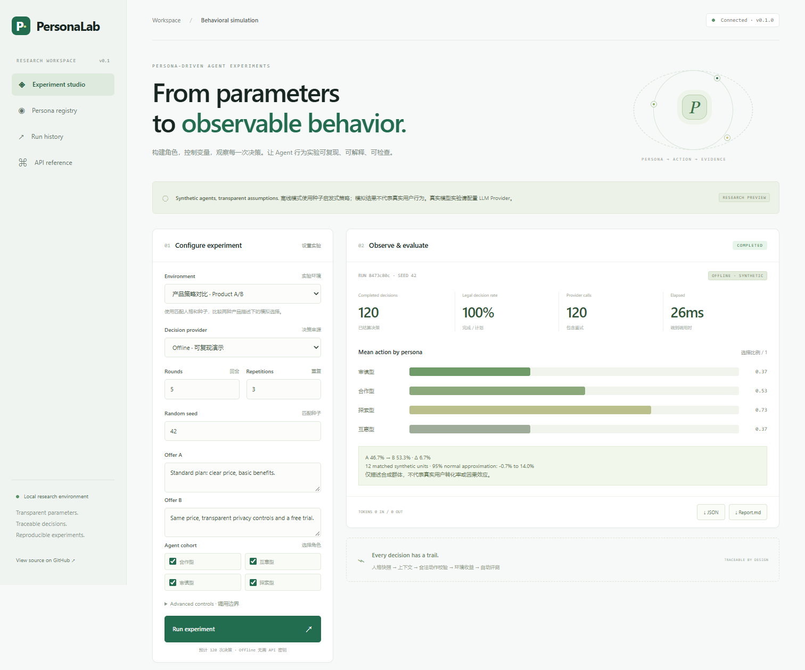

# PersonaLab

A reproducible persona-driven behavioral experiment platform with an inspectable LLM agent harness, REST API, CLI, and browser console.

[中文详细文档](README.md) · [Architecture](docs/architecture.md) · [Experiment methods](docs/experiments.md)



PersonaLab turns structured personality traits, social preferences, and decision tendencies into bounded agent experiments. It supports public goods, two-stage trust interactions, and matched synthetic product A/B comparisons.

Two providers are intentionally distinguished: **Offline** is a seeded heuristic teaching baseline; **OpenAI-compatible** uses a real chat completion endpoint. Offline results are never presented as real LLM evaluation or evidence of human predictive validity.

## Quickstart

Requires Python 3.11+.

```bash
git clone https://github.com/rryyyi/Agent-Project-4.git
cd Agent-Project-4
python -m venv .venv
# Activate your virtual environment for your shell.
python -m pip install -e ".[dev]"
personalab serve
```

Open http://127.0.0.1:8000 and try the sample experiment. Interactive API documentation is at `/docs`.

```bash
personalab run --config examples/public_goods.json --output artifacts/public-goods
personalab run --config examples/trust_game.json --output artifacts/trust
personalab run --config examples/product_ab.json --output artifacts/ab
python scripts/reproduce.py
```

Runs export `run.json` and `report.md`; SQLite keeps terminal snapshots. The reproduction script compares actual decisions and metrics with committed examples, excluding UUIDs, timestamps and timings.

## Real LLM setup

Set `OPENAI_API_KEY` and optionally `OPENAI_BASE_URL` in your shell. Change the model in `examples/llm.json`, then run:

```bash
personalab run --config examples/llm.json --output artifacts/llm
```

The endpoint must support JSON object response format, seed, temperature and max_tokens. Missing credentials fail explicitly. Provider failures never trigger an undisclosed offline fallback. Persona/context data is sent to the configured provider. The CLI does not automatically load `.env` files.

Use `PERSONALAB_PERSONAS` to load a custom JSON persona array. Unknown fields, nonfinite trait values and duplicate IDs are rejected. Each run stores the exact persona snapshot.

## Engineering highlights

- Versioned Pydantic contracts for personas, experiment configuration and decisions.
- Round barriers prevent same-round observation leakage in public goods.
- Trust agents first transfer funds; trustees observe received funds before deciding a return fraction.
- Stable SHA-256 derived seeds and isolated variant histories for paired A/B comparisons.
- Bounded retries, timeouts, concurrency and total call budget.
- Per-attempt contexts, validated decisions, usage, timings and sanitized failure categories.
- Atomic SQLite terminal snapshots; JSON and Markdown exports with provenance.
- Exact text/PDF evidence candidates with Unicode offsets, text hashes and page anchors.
- Browser dynamic content rendered via textContent; optional real-browser smoke test.
- Python matrix CI, tests, Ruff, wheel build, Docker, maintenance policies and issue templates.

## Validation

```bash
python -m ruff check src tests scripts
python -m ruff format --check src tests scripts
python -m pytest -q
python -m build
```

Optional UI check with system Microsoft Edge:

```bash
python -m pip install playwright
python scripts/verify_browser.py
```

Container:

```bash
docker compose up --build
```

The service is local and single-user. It has no authentication, durable queue, mid-run recovery, distributed quota, or claim of production scale. LLM runs are request-bound; use the CLI for long experiments. The default server binds to loopback.

Persona values are hand-authored assumptions. Offline alignment scores are implementation checks because the policy directly uses the parameters. A/B intervals are descriptive normal approximations over synthetic matched units, not evidence of real-user causal effects. Explanations and confidence are self-reported. No paid real-model benchmark is included.

See [verification notes](docs/verification.md) for actual checks and untested boundaries, [CONTRIBUTING](CONTRIBUTING.md) for changes, and [SECURITY](SECURITY.md) for reporting. MIT licensed.
