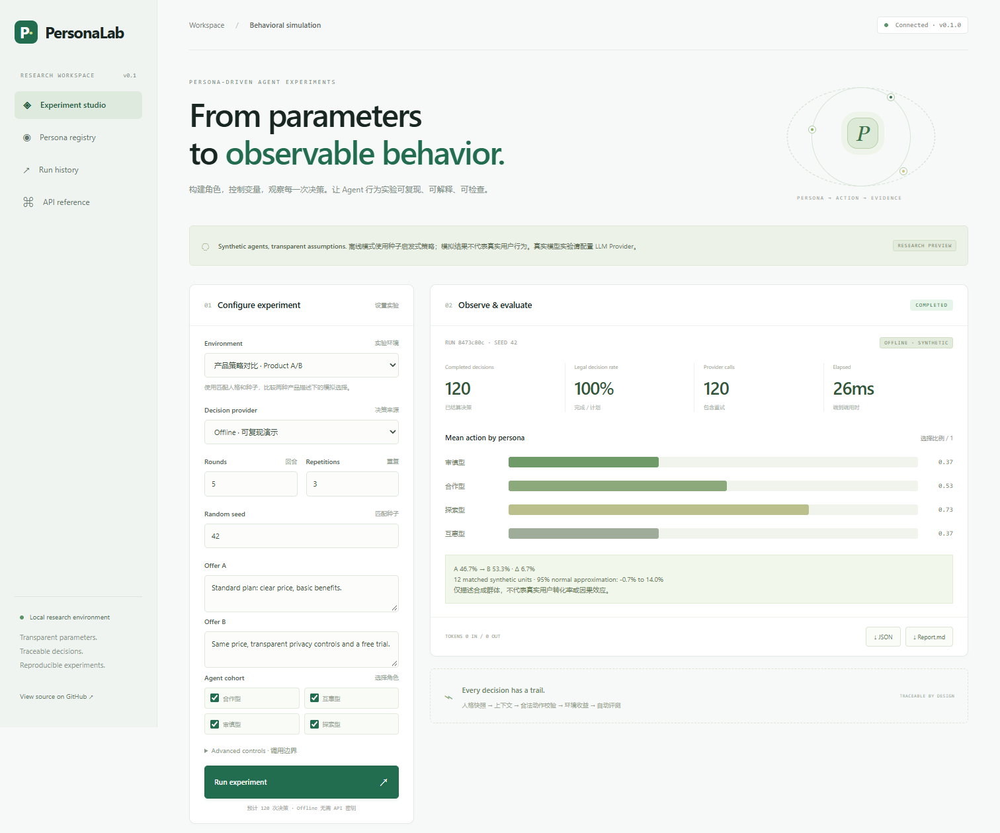
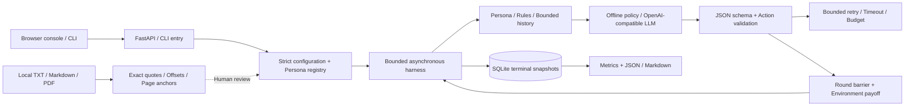

<div align="center">

# PersonaLab

### 从人格参数到可观察行为的 LLM Agent 实验平台

**Persona Modeling · Agent Harness · Behavioral Simulation · Evaluation**

[](https://github.com/rryyyi/Agent-Project-4/actions/workflows/ci.yml)
[](pyproject.toml)
[](src/personalab/api.py)
[](LICENSE)

[快速开始](#快速开始) · [架构](#架构与执行流程) · [实验方法](docs/experiments.md) · [工程设计](docs/architecture.md) · [English](README.en.md)

</div>



PersonaLab 将 **结构化人格 → 场景上下文 → Agent 决策 → 环境结算 → 轨迹评测 → 自动报告** 串成一个可以实际运行、检查和复现的闭环。项目围绕“基于 LLM Agent 的行为模拟应用实验”构建，展示人格建模、Prompt Engineering、异步编排、模型输出约束、实验控制和端到端交付。

仓库提供两种明确区分的决策来源：**Offline** 是无需密钥、可复现的种子启发式基线；**OpenAI-compatible** 将同一套人格、场景和输出契约发送给真实模型。离线数据始终标注为合成演示，不计作真实 LLM 评测结果。

## 这个项目解决什么问题

只有“你是一个合作型用户”的 Prompt 很难回答：角色到底由哪些参数定义？模型是否输出了合法动作？失败后调用了几次？实验中的变化来自策略还是随机性？结论能否被其他人重跑？

PersonaLab 将这些问题落实为可以查看的工程边界：

| 问题 | 实现 | 可检查产物 |
| --- | --- | --- |
| 人格定义模糊 | Big Five、社会偏好、风险偏好统一 JSON Schema | [人格配置](src/personalab/data/personas.json)、运行时快照 |
| 模型输出不可靠 | Pydantic 输出契约、动作空间校验、有限重试 | 每次调用的状态、耗时与校验后动作 |
| 多 Agent 信息穿越 | 公共物品博弈使用轮次屏障，当前轮同时行动 | 每次调用的上下文与历史窗口 |
| 长链路调用失控 | 并发、超时、重试、总调用预算 | `calls_used`、`attempts`、失败类别 |
| 实验难复现 | 稳定的 SHA-256 派生种子、配置摘要、人格快照 | `run.json` 与 `report.md` |
| A/B 模拟结论夸大 | 匹配人格和种子，先在单元内聚合回合 | 配对差值、近似区间与解释边界 |
| 文献引用不落地 | 原文句子候选、字符偏移、PDF 页码、文本摘要 | 可回指原文的证据 JSON |

## 快速开始

要求：Python 3.11–3.14、Git。默认演示不需要模型账号或 API 密钥。

```bash
git clone https://github.com/rryyyi/Agent-Project-4.git
cd Agent-Project-4
python -m venv .venv
```

激活环境：

```bash
# macOS / Linux
source .venv/bin/activate

# Windows PowerShell
.venv\Scripts\Activate.ps1
```

安装并启动：

```bash
python -m pip install -e ".[dev]"
personalab serve
```

打开 **http://127.0.0.1:8000**。点击 **Try a product A/B experiment** 可运行默认演示；界面显示角色分组、行为均值、执行指标、配对差异与逐轮轨迹。API 文档位于 **http://127.0.0.1:8000/docs**。

或在终端运行：

```bash
personalab run --config examples/public_goods.json --output artifacts/public-goods
personalab run --config examples/trust_game.json --output artifacts/trust-game
personalab run --config examples/product_ab.json --output artifacts/product-ab
```

每次生成：

```text
artifacts/product-ab/
├── run.json       # 配置、人格快照、指标、动作、每次调用上下文和状态
└── report.md      # 实验来源、指标、配置、决策样本、解释限制
```

运行历史保存在 `artifacts/personalab.db`。CLI、API 和界面共享实验引擎及存储格式；CLI 支持 `--db` 指定独立数据库。终端 JSON 摘要中的 `status` 才表示实验是否成功；CLI 完成退出码为 0，实验失败为 1，输入/路径/配置问题为 2。

## 三种实验环境

| 场景 | Agent 动作 | 环境规则 | 可观察现象 |
| --- | --- | --- | --- |
| 公共物品博弈 `public_goods` | 每人贡献 `0..10` | 每人初始 10，公共池乘 1.6 后平均分配 | 合作程度、历史互惠、个人/共同收益 |
| 信任博弈 `trust_game` | 投资者转账 `0..10`；受托者返还比例 `0..1` | 转账乘 3，受托者观察到账后决策 | 风险承担、信任、互惠返还 |
| 产品 A/B `product_ab` | 接受 `1` 或拒绝 `0` | 相同人格与重复编号匹配种子，分别观察两份产品描述 | 合成群体选择差异、人格异质性 |

信任博弈采用环形配对：每个人格每轮投资一次，并作为前一个人格的受托者行动一次；只有一个人格时为自博弈。两种角色的动作单位不同，不应直接解释混合的平均动作。公共物品社会困境的经济解释依赖人数；默认 4 人时 `1 < 1.6 < 4`，单人配置仅用于测试/演示。

A/B 中 A、B 分支的历史相互隔离，但每个分支内会观察前轮群体结果。它测量该模拟环境中的策略差异，不等同于线上随机试验。

## 人格参数与自定义

四类内置角色为合作型、互惠型、审慎型和探索型。它们是**手工定义的教学人格**，参数未经过心理测量或真实用户数据校准；没有将论文与参数做虚假的一一对应。

```json
{
  "schema_version": "1.0",
  "id": "cooperator",
  "name": "合作型 · Cooperator",
  "description": "教学用合成人格，重视共同收益。",
  "traits": {
    "openness": 0.65,
    "conscientiousness": 0.8,
    "extraversion": 0.7,
    "agreeableness": 0.9,
    "neuroticism": 0.2
  },
  "social": {"cooperation": 0.9, "reciprocity": 0.65, "fairness": 0.85},
  "preferences": {"risk_tolerance": 0.55, "loss_aversion": 0.3},
  "evidence": []
}
```

所有数值限定在 `[0,1]`，拒绝 NaN、Infinity 和未知字段；人格 ID 必须唯一。自定义时复制内置 JSON 数组，修改参数后设置环境变量：

```bash
# macOS / Linux
export PERSONALAB_PERSONAS=./examples/my-personas.json

# PowerShell
$env:PERSONALAB_PERSONAS="./examples/my-personas.json"
```

重启服务或运行 CLI。实验配置中的 `personas` 应填写新文件实际存在的 ID。Prompt 保留人格结构，输出 `parameter_refs` 必须指向存在的数值字段。这里校验的是引用合法性，不能据此证明模型的解释与内部推理一致。

## 接入真实 LLM

配置 OpenAI 或兼容 `/chat/completions` 的服务，然后使用 [examples/llm.json](examples/llm.json)：

```bash
# macOS / Linux
export OPENAI_API_KEY="your-key"
export OPENAI_BASE_URL="https://api.openai.com/v1"
personalab run --config examples/llm.json --output artifacts/llm
```

```powershell
# Windows PowerShell
$env:OPENAI_API_KEY="your-key"
$env:OPENAI_BASE_URL="https://api.openai.com/v1"
personalab run --config examples/llm.json --output artifacts/llm
```

模型名在实验 JSON 的 `model` 字段中设置。Web 界面选择 LLM 后可以填写 Model ID。密钥只由服务端环境变量读取；浏览器不需要提交密钥。`.env.example` 是配置参考，**Python CLI 不会自动读取 `.env`**；Docker Compose 会读取项目 `.env` 的变量替换。

适配器使用 JSON object response format、`temperature=0.2`、`seed`、`max_tokens=500`。兼容服务必须支持这些字段；不支持时返回明确失败，不会悄悄切换为 Offline。种子与低温度无法保证真实模型逐位复现。Provider 的 HTTP 429、5xx、认证失败、网络错误和超时被归类，异常原文不写入公共结果。

每次请求包含相关人格、场景和有界历史，这些数据会发送给所配置的模型服务。不要把敏感的真实用户信息放入人格和历史。这里没有为了发布项目执行付费模型调用；仓库中的样例结果均来自 Offline。

## 架构与执行流程



核心状态流：`running → completed / failed`。每一轮所有必要动作通过校验后才结算收益；中途失败时，已结算轮次保留，未结算动作保留在对应调用的 `validated_decision` 中。不会为缺失动作填造默认值。

`attempts` 记录上下文、种子、调用序号、重试编号、输入/输出 Token、耗时与状态。输出中的 `explanation` 是简短行为说明，系统不要求或公开模型内部思维链。

| 模块 | 责任 |
| --- | --- |
| `schemas.py` / `personas.py` | 配置、人格、输出契约和注册表 |
| `scenarios.py` | 合法动作与环境收益规则 |
| `prompts.py` / `providers.py` | 指令与数据边界、Provider 协议和适配 |
| `engine.py` | 轮次屏障、调用预算、并发、重试、超时与轨迹 |
| `evaluation.py` / `reports.py` | 指标定义、配对比较、报告输出 |
| `storage.py` | 参数化 SQLite 查询与原子终态快照 |
| `literature.py` | 本地文档读取与可核对的证据候选 |
| `api.py` / `cli.py` / `static/` | 服务、批量入口和交互控制台 |

详见 [架构与设计决策](docs/architecture.md)。

## 实验配置与调用边界

| 字段 | 默认值 | 边界 / 语义 |
| --- | --- | --- |
| `scenario` | `public_goods` | 三种固定环境 |
| `provider` | `offline` | `offline` / `openai` |
| `personas` | 4 个内置 ID | 1–12 个，无重复 |
| `rounds` | 5 | 1–100 |
| `repetitions` | 3 | 1–50，每次重置历史 |
| `seed` | 42 | 0–2³²−1 |
| `concurrency` | 4 | 1–16 个并发 Provider 调用 |
| `max_calls` | 1000 | 1–10000，重试同样消耗预算 |
| `max_retries` | 2 | 0–3，最多尝试 `1 + max_retries` 次 |
| `timeout_seconds` | 30 | 0.01–120，每次调用上限 |
| `history_window` | 4 | 0–20 个历史轮次 |
| `variant_a` / `variant_b` | 示例产品描述 | 各 1–1000 字符 |

计划决策总数限定为 10000。公共物品计划量为 `人格数 × 回合 × 重复`；信任与 A/B 再乘 2。`max_calls` 可以小于计划量，用于明确中止或故障演练。API 单进程同时最多接纳 2 个实验，超过时返回 HTTP 429。

## 评测指标如何理解

| 指标 | 定义 | 解释边界 |
| --- | --- | --- |
| `legal_decision_rate` | 已合法结算动作 / 计划动作 | 完整性指标；不等于所有调用首次成功率 |
| `valid_attempt_rate` | 输出合法的调用 / 实际调用 | 重试前的失败也计入分母 |
| `cooperation_alignment_proxy` | 平均 `1 − abs(贡献/10 − cooperation)` | 仅公共物品；Offline 直接使用参数，因此不是独立科学验证 |
| `by_persona` | 每个人格的动作数、动作与收益均值 | 信任场景有角色单位混合，需查看原始轨迹 |
| `action_distribution` | 已结算动作计数 | 连续场景为精确数值频次，不是分箱密度估计 |
| `ab_comparison` | 每个“人格 × 重复”先平均回合，再配对比较 | 正态近似区间；合成单位不代表独立真人 |
| Token / elapsed | Provider 上报 Token 与实际计时 | 无 usage 时按 0；不估算货币费用 |

A/B 仅纳入 A、B 都有相同已完成回合数的匹配单元。少于 2 个单元时不报告置信区间。完整公式、收益例子、离线策略和复现说明见 [实验方法](docs/experiments.md)。

## 文献信息抽取

```bash
personalab extract examples/literature/teaching-note.txt --keywords cooperation,reciprocity,risk
personalab extract your-paper.pdf --keywords cooperation,trust
```

抽取器当前采用确定性的关键词句子匹配，输出原文、起止字符偏移、规范化文本的 SHA-256、PDF 页码和 `candidate_requires_human_review` 标记。偏移针对 `read_document` 返回的 Unicode 文本；PDF 摘要针对提取文本，不是原始 PDF 二进制。单文件最多 2 MB、PDF 最多 100 页、最多 100 条候选；仅处理具有可选文本的 PDF，当前不包含 OCR。

候选需要人工核对，随后手工写入 Persona 的 `evidence`。系统不自动把关键词匹配解释为论文支持某个数值参数，也不自动生成无法核实的引用。

API 提供 `POST /api/evidence`，接收文本而非任意本地路径；示例原文为本项目编写的教学材料。

## API 使用

```bash
curl http://127.0.0.1:8000/api/health
curl http://127.0.0.1:8000/api/personas
curl -X POST http://127.0.0.1:8000/api/runs \
  -H "Content-Type: application/json" \
  -d '{"scenario":"product_ab","rounds":3,"repetitions":2,"seed":42}'
```

| 方法 | 路径 | 返回 |
| --- | --- | --- |
| GET | `/api/health` | 版本与本地服务状态 |
| GET | `/api/personas` | 当前人格注册表 |
| GET | `/api/scenarios` | 环境规则 |
| POST | `/api/runs` | 运行实验，返回终态 JSON；HTTP 201 表示已保存，请检查 `status` |
| GET | `/api/runs?limit=20` | 最近运行摘要 |
| GET | `/api/runs/{id}` | 完整结果，缺失时 404 |
| GET | `/api/runs/{id}/report` | Markdown 附件 |
| POST | `/api/evidence` | 可回指原文的证据候选 |

实验接口采用**请求内执行**，没有后台持久任务队列；长时间 LLM 实验建议用 CLI。服务重启不能恢复中途实验，也没有多租户认证。默认只监听 loopback。部署到共享网络之前需要自行增加认证、访问限制与反向代理。

## 测试与工程验证

```bash
python -m ruff check src tests scripts
python -m ruff format --check src tests scripts
python -m pytest -q
python -m build
```

测试覆盖人格边界与自定义注册表、三类环境、确定性、轮次隔离、配对种子、异常 JSON、非法参数引用、调用预算、超时、Token 统计、真实适配器协议、SQLite、证据定位、API 生命周期和 CLI 子进程。测试中的真实模型边界通过 httpx MockTransport 隔离，不访问付费服务。

可选真实浏览器验收（需要系统 Edge）：

```bash
python -m pip install playwright
python scripts/verify_browser.py
```

脚本启动真实本地 HTTP 服务，验证实验点击、JSON 下载、100 条轨迹展示、390px 手机布局与 HTML 解释的文本渲染；截图写入 `artifacts/browser/`。仓库截图来自实际运行。自动化 CI 包含 Python 版本矩阵、Linux/Windows 检查、静态检查、测试、构建及容器冒烟，实际状态以顶部 CI 链接为准。

## 复现仓库样例

```bash
python scripts/reproduce.py
```

脚本写入 `artifacts/reproduction/`，并将实际决策与指标同已提交的 [examples/results](examples/results) 比较。复现比较排除运行 UUID、日期和耗时，保留动作、收益、配置和指标。它不会自动覆盖已发布样例；维护者需显式加 `--update` 才会更新样例。

## Docker

```bash
docker compose up --build
```

浏览器访问 `http://127.0.0.1:8000`。容器使用非 root 用户，SQLite 保存到命名卷。可通过项目 `.env` 配置模型变量，不要提交真实密钥。容器构建与健康检查由 CI 验证；本机是否运行过 Docker 见 [验证记录](docs/verification.md)。

## 项目结构

```text
.
├── src/personalab/       # 实验领域、Agent 引擎、Provider、API、CLI 和控制台
├── tests/               # 行为与故障回归测试
├── examples/            # 三类配置、LLM 配置、教学文本、可复现样例
├── scripts/             # 样例复现与真实浏览器验证
├── docs/                # 架构、方法、能力映射、验证与截图
├── .github/             # CI、Dependabot、Issue / PR 模板
├── Dockerfile
├── compose.yaml
└── pyproject.toml
```

## 设计取舍与当前限制

选择轻量原生前端、FastAPI、SQLite 和独立 Provider 协议，便于别人安装与理解核心 Agent 控制逻辑。没有引入需要额外部署的向量库、分布式队列或编排框架；当前任务不依赖这些设施。

- 人格是建模假设；Big Five 词汇不等于经过验证的心理测量。
- 离线策略不是 LLM；它展示系统工作方式及预期参数敏感性。
- 真实 LLM 可能存在偏见、提示词敏感性与服务端不确定性，结构化校验不能证明心理学有效性。
- 参数引用只验证路径存在；简短解释和置信度均为自报告。
- 当前运行保存终态快照，缺少断点恢复、持久队列、认证、多进程全局调用配额。
- 报告中的近似区间用于描述合成结果，不替代真实用户实验或论文级有效性检验。
- 本版本没有执行真实付费 LLM 基准，也没有宣称上线业务收益。

## 进一步阅读与工程展示

- [架构与设计决策](docs/architecture.md)：轮次屏障、故障处理、状态持久化和替代方案。
- [实验方法与公式](docs/experiments.md)：环境规则、离线基线、统计单元与复现。
- [Agent 工程能力与演示路线](docs/engineering-guide.md)：代码入口、5 分钟演示、面试讨论。
- [验证记录](docs/verification.md)、[变更日志](CHANGELOG.md)、[贡献指南](CONTRIBUTING.md)、[安全政策](SECURITY.md)。

方法参考：

1. Park et al. (2023), [Generative Agents: Interactive Simulacra of Human Behavior](https://arxiv.org/abs/2304.03442) — 生成式 Agent、记忆与交互的研究背景；本项目未复现其完整系统。
2. Aher, Arriaga & Kalai (2023), [Using Large Language Models to Simulate Multiple Humans and Replicate Human Subject Studies](https://proceedings.mlr.press/v202/aher23a.html) — 合成人类行为研究与验证边界。
3. Berg, Dickhaut & McCabe (1995), [Trust, Reciprocity, and Social History](https://doi.org/10.1006/game.1995.1027) — 投资/信任实验的经典背景；本实现采用简化、重复的环形配对版本，不声称复现原论文。

本项目采用 [MIT License](LICENSE)。欢迎提交可复现的问题与有明确验证方式的改进。
