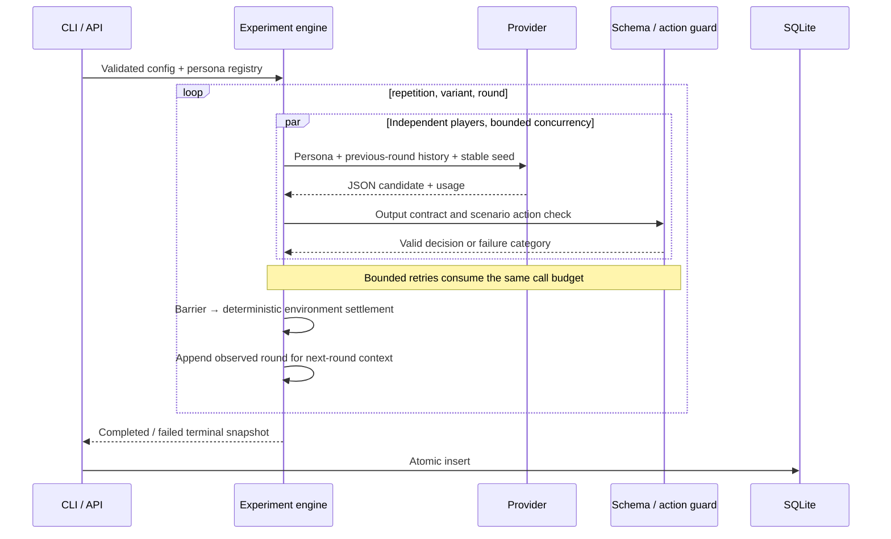

# Architecture and engineering decisions

## Boundaries

PersonaLab is a local single-user experiment workbench. It shares domain code across the CLI and API instead of maintaining separate execution paths. Models reject unknown keys and nonfinite values, scenarios compute payoffs independently of providers, and provider failures never silently replace the configured experiment with a different method.

`schemas.py` owns configuration and output contracts. `personas.py` loads either packaged synthetic personas or a custom array selected by `PERSONALAB_PERSONAS`. `prompts.py` puts the output contract in a system message and JSON-encoded scenario/persona/history data in a user message. This is a useful instruction boundary, not a proof of prompt-injection immunity.

## Execution semantics

Public goods is simultaneous within each round. Every player receives only preceding settled rounds. History resets between repetitions and A/B branches. Trust has two barriers: all investor transfers, then all trustee decisions with observed amounts, then settlement. A persona is paired with the next persona cyclically; roles are not statistically independent samples of people.

Retries apply to transport failures and invalid output. Authentication and unsupported-request failures stop immediately. Backoff is bounded at 0.8 seconds and occurs outside the concurrency slot. All actual provider calls, including invalid-output retries, count toward `max_calls`. Every provider call has an `asyncio.wait_for` timeout; the real adapter also has an HTTP timeout. Third-party providers must cooperate with asyncio cancellation.

A partial round has no fabricated payoff. Its valid candidate outputs remain in `attempts[].validated_decision`; only fully settled rounds enter `decisions` and metrics. This matters when interpreting a failed run: zero settled decisions does not imply zero completed provider calls.

## Reproducibility

Per-unit seeds derive from SHA-256 of root seed, repetition, round, persona ID and role. They do not depend on Python's randomized hash or completion order. Product variants use the same seed for matched units; persona/repetition/round units receive distinct seeds. Offline policy version is recorded as `seeded-heuristic-v1`.

Each run stores the effective config, sorted config SHA-256, exact persona snapshots, package version and Python version. UUID, timestamp and wall time are intentionally nondeterministic. Real model providers may ignore seeds or change server-side model versions, so byte-for-byte reproducibility is not guaranteed there.

## Persistence and lifecycle

SQLite holds one terminal JSON snapshot per UUID, inserted in a transaction. Per-operation connections avoid sharing a mutable connection across API thread workers. WAL mode improves local concurrent reads. Queries are parameterized. The API offloads terminal writes to a thread; synchronous read endpoints run in FastAPI's worker pool.

There is no checkpoint for in-progress runs, resume mechanism or persistent job queue in v0.1.0. A server/process crash can lose in-flight runs. API responses are request-bound; running a large LLM experiment through the CLI avoids reverse-proxy request timeouts. `POST /api/runs` returns 201 when a terminal result is saved, including when its internal status is `failed`.

## Safety and visibility boundaries

The default server binds to 127.0.0.1. API admission is two runs per process; this is not a cross-process quota. There is no authentication or tenant isolation. Container publishing also binds host loopback. Shared deployments need authentication, network controls, durable scheduling and operational limits.

Only sanitized error categories enter results; exception messages and upstream bodies are excluded because they may contain secrets. Successful provider explanations are untrusted content and may contain arbitrary text. The browser uses DOM textContent, and Markdown table content is HTML-escaped. Exported JSON is raw experimental data and should be reviewed before sharing.

Document extraction accepts local files through the CLI; the API accepts bounded text, never a client-supplied server file path. PDF support is text extraction, not OCR. Resource limits reduce accidental oversized input but are not a sandbox for hostile PDFs.

## ADRs

| Decision | Rationale | Cost / next threshold |
| --- | --- | --- |
| Provider protocol instead of framework-managed agent | Explicit control of budgets, validation and trace format; easy network-boundary tests | Add tool-calling protocol when actual tools/scenarios require it |
| SQLite terminal snapshots | Minimal install burden and atomic exportable experiments | Durable job table and object storage needed for recovery/large traces |
| Native browser frontend | No Node build chain needed to run the project | Larger product UI may justify typed component tooling |
| Fixed scenario mechanics | Prevent model-authored rewards and ambiguous action spaces | New scenarios require explicit validation/settlement code and tests |
| Keyword evidence candidates | Verifiable anchors and no fabricated semantic claims | LLM extraction would require quote validation plus expert review |
| No forced fallback provider | Preserves method identity and scientific provenance | Users explicitly rerun with a different provider if desired |
| Normal approximation for paired A/B summary | Transparent lightweight descriptive statistic | Small-sample/interaction-aware methods and external calibration needed for research inference |

## Extensions worth doing next

A durable run queue, resumable checkpoints, pluggable persona registry versioning, real-model evaluation against held-out human datasets, stronger statistics, explicit model revision capture, role-specific trust dashboards, and tool-grounded literature extraction are meaningful next steps. These are roadmap items, not shipped capabilities.
