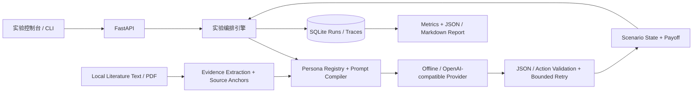

# PersonaLab：LLM Agent 行为模拟实验平台

状态：设计草案，等待用户审阅。技术方案由实现者建议，不代表用户已经批准。

## 1. 项目意图

将简历中的“基于 LLM Agent 的行为模拟应用实验”落地为能够安装、运行、测试、解释并公开展示的工程项目。目标读者包括 Agent 开发岗位面试官、技术评审及希望复现实验的开发者。通过可检查的代码、真实测试和可复现实验体现能力，不捏造业务部署、用户规模、收益或模型效果。

公开仓库不包含简历原文件、电话、邮箱等个人信息。项目建立日期和 Git 提交日期使用真实日期，不倒签简历中的经历时间。

## 2. 方案比较

| 方案 | 优点 | 代价与局限 |
| --- | --- | --- |
| Notebook 研究演示 | 阅读容易、实验迭代快 | API、持久化、可靠性和产品交付能力不充分 |
| CLI + API 实验引擎 | 后端清晰、易于自动化和测试 | 非技术读者缺少直观入口 |
| 实验引擎 + API + 轻量交互界面 | 同时展示 Agent 工程、实验方法和端到端交付 | 需要覆盖界面与后端集成 |

推荐第三种。使用 Python、FastAPI、Pydantic、SQLite、原生 HTML/CSS/JavaScript。避免为展示引入独立前端构建链与复杂分布式基础设施。离线策略用于可复现演示；OpenAI 兼容适配器用于真实 LLM 行为实验，两者在界面、报告和数据中明确标记。

## 3. 目标与验收

1. 在未配置 API 密钥时可运行完整离线演示；可按环境配置切换到真实 LLM。
2. 用版本化 JSON 定义多类人格，约束人格特征、社会偏好、风险倾向及证据来源。
3. 至少支持公共物品博弈、信任博弈和产品策略 A/B 选择三种场景；每种场景定义合法动作、环境与收益/结果计算。
4. 形成“配置校验 → 任务分配 → 行为生成 → 输出校验与有限重试 → 状态更新 → 指标与报告”的执行链。
5. 实验具备种子、配置快照、版本信息、动作轨迹、模型标识、耗时、Token 使用与失败记录，支持持久化查询和导出。
6. 提供人格一致性、合法动作率、行为分布、各组差异等明确指标。A/B 结果仅描述模拟群体，不宣称真实用户因果效应。
7. 文献抽取提供本地文本/PDF 输入及来源片段定位；结构化候选必须保留证据并经过校验。模型生成内容不自动当成文献事实。
8. README 包含快速启动、架构、数据结构、API、实验复现、真实 LLM 配置、评测方法、局限和排障；另外提供开发、设计决策及岗位能力映射文档。
9. CI 运行代码风格/静态检查与测试。补充依赖声明、容器、许可证、贡献指南、安全政策、Issue/PR 模板。
10. 本地验收通过后提交代码并推送指定远端；在认证允许时维护仓库简介、topics 和版本发布。

## 4. 范围边界

本版本为单用户本地/演示系统，不声称生产多租户服务。暂不加入账号系统、Kubernetes、消息中间件或向量数据库。人格参数是可检查的建模假设，不是心理测量诊断。稳定不等同于对真人行为预测有效；可解释性指可见的输入参数、决策摘要与证据关联，不公开或要求模型内部思维链。

## 5. 核心模型

### Persona

字段包括 id、name、description、Big Five 五维特征（0–1）、social_preferences（如 reciprocity、fairness、cooperation，0–1）、decision_preferences（risk_tolerance、loss_aversion 等）、evidence 引用、schema_version。为合作型、互惠型、风险规避型和探索型提供示例，并说明参数取值是演示假设。

### Scenario / ExperimentConfig

场景声明动作空间、回合数、预算、收益规则与可观察历史。实验声明 personas、scenario、provider、model、seed、重复次数、并发和总调用预算。A/B 实验使用相同人格和匹配种子，保持除策略变量以外的条件一致。

### Decision / Trace

动作包含明确数值或枚举、简短理由、置信度及参数引用。轨迹记录 run_id、agent_id、round、输入摘要、动作、校验状态、重试次数、耗时、usage、失败类别。理由是面向用户的行为说明，不视为模型内部推理的忠实记录。

## 6. 架构与执行



模块建议：schemas、personas、scenarios、prompts、providers、engine、storage、evaluation、reports、literature、api、cli。路径和内部类名可由实现阶段调整。提供供应商协议与 fake provider，避免测试访问网络。

引擎为每个实验生成独立状态，每个 Agent 获得有界历史，按轮次更新共享环境。采用受控并发，限制回合、Agent 数量、请求超时和重试次数。失败明确记录，不把离线结果伪装成真实 LLM 返回。SQLite 事务保证结果与状态的一致性，实验终态至少包括 completed 和 failed。

OpenAI 兼容适配器从环境读取密钥和端点，不在响应或日志中返回密钥。处理限流、临时网络故障、无效 JSON 和超时；请求预算防止失控调用。真实模型实验需要用户自行配置凭据；实现不依赖获得付费调用权限。

## 7. 交互界面

轻量单页控制台：

```text
PersonaLab                         Provider: Offline / LLM
Persona-driven behavioral simulation
[场景选择] [人格组] [回合] [种子] [运行实验]

运行摘要：状态 / 样本数 / 合法动作率 / 费用相关 usage
[行为分布图] [人格分组指标]
回合轨迹：角色 / 动作 / 收益 / 解释 / 校验
[下载 JSON] [下载 Markdown 报告]
```

界面支持中文说明、响应式布局、加载/失败状态，并明确标注离线结果。文献抽取可先以 CLI 与 API 交付，避免界面膨胀。

## 8. 评测与实验方法

- 正确性：模型字段边界、各场景动作空间与收益、存储事务、接口输入校验、供应商故障处理。
- 可复现性：离线同配置同种子返回相同决策/指标（不要求 run_id 和时间戳相同）。真实 LLM 不承诺逐位复现。
- 人格一致性：按场景预定义行为指标与人格参数的关系，报告代理指标及其定义，不称为心理学有效性验证。
- A/B：匹配实验单元、样本数量、差异和不确定性；使用标准库/轻依赖实现可解释统计。明确相关 Agent 轨迹不能当成独立真人样本。
- 文献：引用来源片段必须能回指原文；测试拒绝缺失或不匹配的证据。
- 集成：通过 FastAPI TestClient 验证创建、读取、报告导出、无效配置与失败路径；CLI 冒烟与真实本地 HTTP 检查。
- 真实 LLM：没有密钥时只验证适配器契约和模拟故障，不公布真实模型准确率。

## 9. 文献与样例

README 引用可核实的人格、社会模拟和行为实验文献，区分借鉴方法与复现论文。仓库只附自主编写的教学样例与来源信息，不复制未知许可的论文全文。提交小规模真实生成的离线样例报告，包含生成命令与配置，以便审阅者重跑。

## 10. 发布与维护

采用正常 Git 历史，按设计、核心能力、界面文档、验收发布分阶段提交。添加 GitHub Actions、Issue 表单和 PR 模板，避免自动制造无意义 Issue、虚构使用数据或伪造贡献。若远端权限和网络可用，更新 description/topics，发布带说明的 v0.1.0；不修改可见性、协作者、付费选项或安全设置。

## 11. 已发现的环境条件

本地文件夹起初为空，远端为公开空仓库。现已初始化 main 并设置 origin。系统有 Python 3.14、pytest、FastAPI、Pydantic、httpx、pypdf；未安装 GitHub CLI。GitHub 直连超时，经本机已有 HTTP 代理 127.0.0.1:7890 的只读 ls-remote 检查成功。后续优先对 Git 命令逐次指定代理，不改变系统全局设置。认证与写权限尚未验证。

## 12. 待实现者裁量

精确依赖版本、目录布局、图表实现、指标算法细节与测试数量由实现者依据运行结果确定；所有公开的成功声明必须有命令输出或生成产物支持。没有子 Agent 工具时由当前实现者自行进行设计可实施性检查与最终代码复核。
